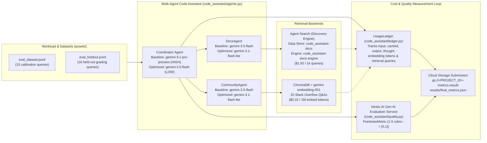

# Step-by-Step Lab Manual: Code Assistant Agent Cost & Quality Optimization (ADK + Agent Search + Vertex AI Evaluation)

This manual walks through measuring, attributing, and optimizing the per-query cost and answer quality of a multi-agent **Code Assistant Agent** built with the **Google Agent Development Kit (ADK)**, **Agent Search (Discovery Engine)**, **ChromaDB**, **Gemini 3 Family Models**, and the **Vertex AI Gen AI Evaluation Service**.

---

## Architecture Overview



---

## Repository Structure

```text
.
├── README.md                                 # Step-by-Step Lab Manual & Architecture Overview
├── STEP_BY_STEP_MANUAL.md                    # Full Step-by-Step Lab Manual
├── code_assistant_cost_optimization.ipynb    # Completed Lab Notebook (Parts 0–6 with Final Challenge)
├── final_metrics.json                        # Verified Final Challenge grading submission (PASS)
├── notebook_config.sh                        # Workbench startup script
├── assets/                                   # Retrieval corpora and evaluation datasets
│   ├── docs.jsonl                            # 20 Python error notes indexed in Agent Search
│   ├── stackoverflow.jsonl                   # 20 community Q&A posts indexed in ChromaDB
│   ├── eval_dataset.jsonl                    # 15 queries with reference answers (Parts 1–5)
│   └── eval_holdout.jsonl                    # 16 held-out queries for Part 6 Final Challenge
└── code_assistant/                           # Multi-agent plumbing & measurement package
    ├── __init__.py
    ├── agents.py                             # ADK Coordinator, DocsAgent, CommunityAgent wiring
    ├── data.py                               # JSONL loader
    ├── display.py                            # Scorecard & verdict HTML formatters
    ├── ledger.py                             # UsageLedger for per-event cost attribution
    ├── quality.py                            # Vertex AI EvalTask & PointwiseMetric judge rubric
    ├── retrieval.py                          # gemini-embedding-001 + in-memory ChromaDB index
    └── vais.py                               # Discovery Engine Data Store & Search Engine provisioning
```

---

## Cost Model Reference (July 2026 List Prices)

All model, embedding, and retrieval events are attributed via `UsageLedger` and priced using `cost_of(record)`:

| Component / Model | Input ($ / 1M tokens) | Cached Input ($ / 1M tokens) | Output & Thought ($ / 1M tokens) | Flat / Per-Query Rate |
|---|---|---|---|---|
| `gemini-3.1-pro-preview` | $2.00 | $0.20 | $12.00 | — |
| `gemini-3.5-flash` | $1.50 | $0.15 | $9.00 | — |
| `gemini-3.1-flash-lite` | $0.25 | $0.025 | $1.50 | — |
| `gemini-2.5-pro` | $1.25 | $0.13 | $10.00 | — |
| `gemini-2.5-flash` | $0.30 | $0.03 | $2.50 | — |
| `gemini-embedding-001` | $0.15 | — | — | — |
| `vais_query` (Agent Search) | — | — | — | $1.50 / 1,000 queries |

> **Important**: Reasoning (`thought_tokens`) are billed at the **output token rate** and share the `max_output_tokens` ceiling (`3,072` for Coordinator, `2,048` for sub-agents) with the final response.

---

## Task 1: Open the JupyterLab on Agent Platform Workbench

1. In the Google Cloud Console, navigate to **Agent Platform > Notebooks > Workbench** (or search for **Agent Platform Workbench** in the top search bar).
2. Locate the **`generative-ai-jupyterlab`** instance (in `us-central1-a`) and click **Open JupyterLab**.

---

## Task 2: Get the Lab Files

### Step 2.1: Confirm the Lab Files Are Present
In the JupyterLab File Browser (`/home/jupyter`), verify that the following exist:
- `code_assistant_cost_optimization.ipynb`
- `code_assistant/`
- `assets/`

### Step 2.2: Copy the Lab Files Manually (If Missing)
If the files are not present in your home directory, open a terminal (**File > New > Terminal**) and run:

```bash
gcloud storage cp -r "gs://<PROJECT_ID>-bucket/*" ~/
```

---

## Task 3 & Task 4: Run the Lab Notebook & Provision Agent Search Resources

### Step 3.1: Install Dependencies and Restart Kernel (Part 0)
Open `code_assistant_cost_optimization.ipynb` with the **Python 3** kernel and run the setup cells:

```python
%pip install -q google-adk==2.3.0 "google-cloud-aiplatform[evaluation]>=1.158.0" "google-genai>=2.10.0" "chromadb>=1.5.9" "google-cloud-discoveryengine>=0.20.0" pandas matplotlib
```

Restart the kernel when prompted, then initialize the project and environment:

```python
import os

PROJECT_ID = !(gcloud config get-value project)
PROJECT_ID = PROJECT_ID[0]
PROJECT = os.environ.get("GOOGLE_CLOUD_PROJECT", PROJECT_ID)
LOCATION = "global"           # the Gemini 3 family serves from the global endpoint
EVAL_LOCATION = "us-central1" # the Gen AI evaluation service is regional
```

### Step 3.2: Provision Agent Search (Task 4) and ChromaDB Index
Run the provisioning cell under **Part 0: Setup, the cost model, and the ledger -> Provision retrieval and assemble the agent**:

```python
VAIS_LOCATION, DS_ID, ENGINE_ID = "global", "code_assistant-docs", "code_assistant-docs-engine"
DOCS_SC = vais.ensure(PROJECT, VAIS_LOCATION, DS_ID, ENGINE_ID, load_jsonl("assets/docs.jsonl"))
print("DocsAgent backend: Agent Search engine", ENGINE_ID)

so      = load_jsonl("assets/stackoverflow.jsonl")
dataset = load_jsonl("assets/eval_dataset.jsonl")    # 15 queries, easy -> hard multi-part
holdout = load_jsonl("assets/eval_holdout.jsonl")    # 16 held-out queries (final challenge only)
community = build_index(so, MODELS["embedding"], PROJECT, LOCATION, name="community")
print("indexed %d Stack Overflow posts into ChromaDB" % len(so))
```

This provisions the required Discovery Engine resources for **Task 4**:
- **Data Store ID**: `code_assistant-docs`
- **Search Engine ID**: `code_assistant-docs-engine`
- **Serving Config**: `projects/<PROJECT_ID>/locations/global/collections/default_collection/engines/code_assistant-docs-engine/servingConfigs/default_search`

---

### Step 3.3: Measure Baseline & Apply Optimization Levers (Parts 1–5)

| Part / Configuration | Coordinator Model | Sub-Agent Models (`docs`, `community`) | `thinking_level` | `top_k` | Key Takeaway |
|---|---|---|---|---|---|
| **Part 1: Baseline** | `gemini-3.1-pro-preview` | `gemini-3.5-flash` | `HIGH` | `3` | Reference baseline (~$0.026/query, quality ~0.90+); Coordinator Pro synthesis & thought tokens dominate cost. |
| **Part 2: Lever 1a (Model Tiering)** | `gemini-3.5-flash` | `gemini-3.5-flash` | `HIGH` | `3` | Drops cost by ~25–40% while preserving quality within judge variance. |
| **Part 2: Lever 1b (Flash-Lite Trap)** | `gemini-3.1-flash-lite` | `gemini-3.5-flash` | `HIGH` | `3` | High cost & quality variance ($0.007–$0.048/query); `HIGH` thinking on a compact coordinator model is unpredictable. |
| **Part 3: Lever 2 (Context Caching)** | `gemini-3.5-flash` | — | — | — | Cuts cached prefix input token cost by 90% ($1.50 -> $0.15/1M tokens) when prefix >= 4,096 tokens. |
| **Part 4: Lever 3a (Thinking Dial)** | `gemini-3.5-flash` | `gemini-3.5-flash` | `LOW` | `3` | Collapses Coordinator `thought_tokens` ($9/1M output rate), reducing cost another ~15–35% at steady quality. |
| **Part 4: Lever 3b (Retrieval Trim)** | `gemini-3.5-flash` | `gemini-3.5-flash` | `LOW` | `2` | Trims retrieved grounding snippets from 3 to 2 per lookup, slightly reducing sub-agent input tokens. |
| **Part 5: Bonus (Semantic Cache)** | `SemanticCache` (`gemini-embedding-001`) | — | — | — | Serves paraphrased repeat queries (cosine similarity >= `0.85`) for the cost of 1 embedding call. |

---

## Task 5: Optimize the Code Assistant Agent's Cost and Quality (Part 6: Final Challenge)

### Challenge Criteria
- **Target Budget (`BUDGET`)**: `<= $0.0135` per query on the 16-query held-out set (`assets/eval_holdout.jsonl`)
- **Quality Floor (`QUALITY_FLOOR`)**: `>= 0.90` on the [0, 1] normalized autorater rubric
- **Constraint**: `MY_MODELS["coordinator"]` must be `"gemini-3.1-pro-preview"` or `"gemini-3.5-flash"` (cannot be `"gemini-3.1-flash-lite"`). Sub-agent model tiers are unrestricted.

### Why Straightforward Lever Combination Falls Short — and How to Win
Even after tiering the `Coordinator` to `gemini-3.5-flash` with `thinking_level="LOW"` and `top_k=2`, each query still invokes `DocsAgent` and `CommunityAgent` twice (once to issue the tool call, once to synthesize the retrieved snippets). At `gemini-3.5-flash` rates ($1.50/1M input, $9.00/1M output), the sub-agents become the largest remaining token expense.

Because sub-agents perform straightforward retrieval-grounded summarization without `HIGH` reasoning, tiering **both sub-agents** (`docs` and `community`) down to **`gemini-3.1-flash-lite`** ($0.25/1M input, $1.50/1M output — **6x cheaper** than Flash) while keeping the `Coordinator` on **`gemini-3.5-flash`** at **`MY_THINKING = "LOW"`** and **`MY_TOPK = 2`** brings total cost down to **~$0.0109/query** while achieving **0.9531 quality**.

### Step 5.1: Fill in the Final Challenge Configuration Cell (`Part 6`)
In the first code cell under **Part 6: Final challenge**, fill in the `TODO` block as follows:

```python
# ===================================================================================================================
# [TODO: YOUR OPTIMIZATION (fill in every TODO below; the assert stops the cell until you do)]
MY_MODELS = {"coordinator": "gemini-3.5-flash",      # Lever 1: reliable Flash coordinator
             "docs":        "gemini-3.1-flash-lite", # Tier DocsAgent to Flash-Lite (6x cheaper per token)
             "community":   "gemini-3.1-flash-lite", # Tier CommunityAgent to Flash-Lite (6x cheaper per token)
             "embedding":   "gemini-embedding-001"}  # Embedding model
MY_THINKING = "LOW"   # Lever 3a: minimize coordinator thought token spend
MY_TOPK     = 2       # Lever 3b: trim retrieval breadth to 2 snippets per lookup
MY_MAXOUT   = None    # Keep default 3,072 ceiling so answers are never truncated
# ====================================================================================================================
```

### Step 5.2: Run the Submission Cell to Save & Upload `final_metrics.json`
Run the final tracking cell in **Part 6**:

```python
# Do not remove or modify this cell, it will be used for tracking purposes
import json
from google.cloud import storage

PROJECT_ID = !(gcloud config get-value project)
PROJECT_ID = PROJECT_ID[0]
RESULT_BUCKET = f"{PROJECT_ID}-metrics-result"

results = {
    "cost_per_query": cap['cost_per_query'],
    "quality": cap['quality'],
    "budget": BUDGET,
    "quality_floor": QUALITY_FLOOR,
    "passed": res['passed']
}

# save locally
with open("/home/jupyter/final_metrics.json", "w") as f:
    json.dump(results, f, indent=2)

# upload to GCS
client = storage.Client(project=PROJECT_ID)
bucket = client.bucket(RESULT_BUCKET)
blob = bucket.blob("results/final_metrics.json")
blob.upload_from_filename("/home/jupyter/final_metrics.json")

print(f"Uploaded to gs://{RESULT_BUCKET}/results/final_metrics.json")
```

### Verified Final Challenge Output (`final_metrics.json`)

```json
{
  "cost_per_query": 0.0109102125,
  "quality": 0.9531,
  "budget": 0.0135,
  "quality_floor": 0.9,
  "passed": true
}
```
